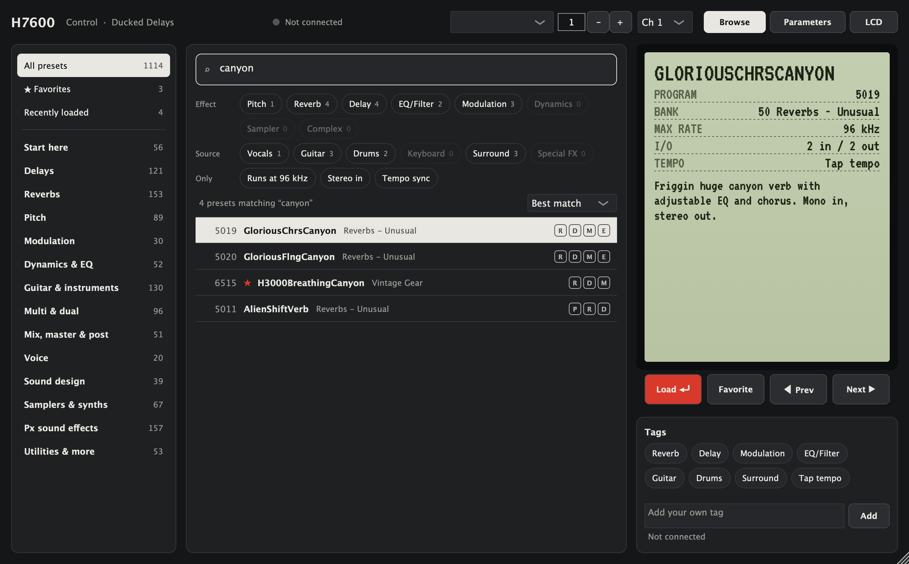
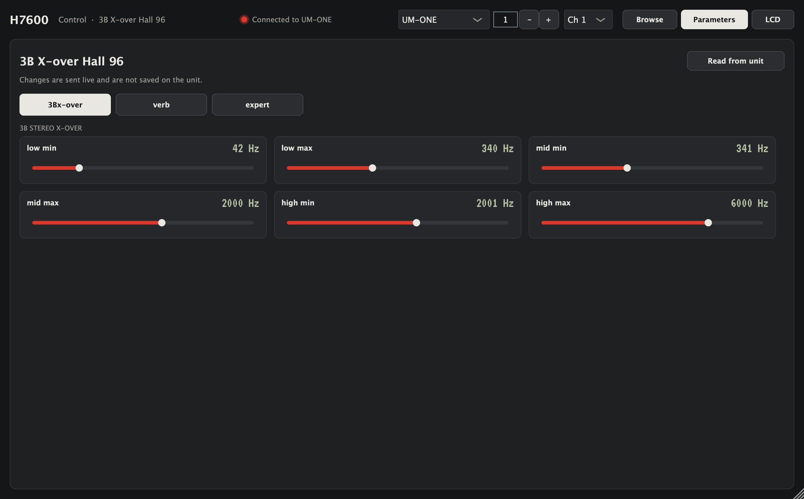
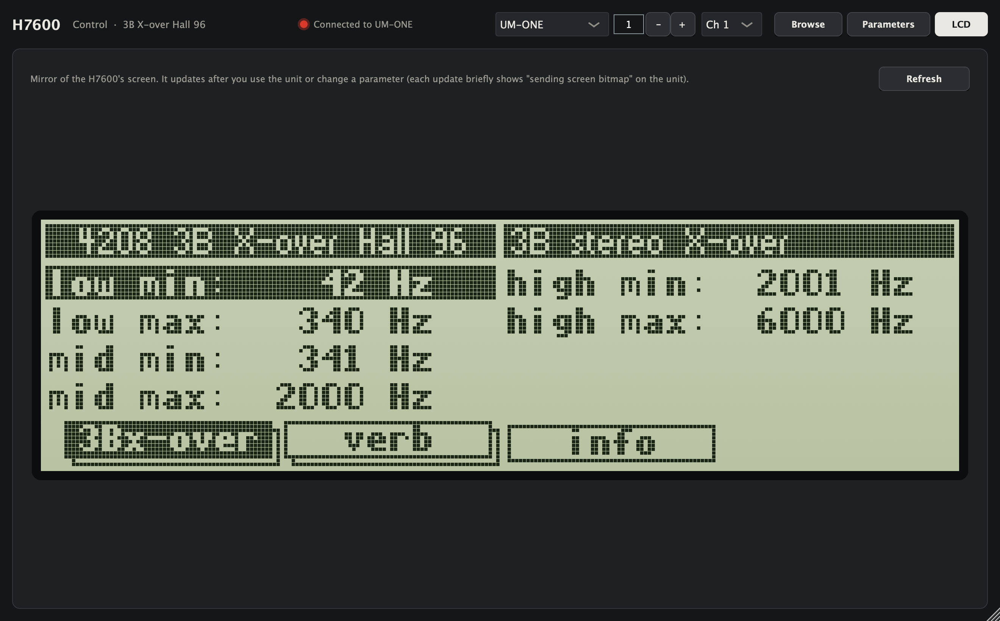

# H7600 Control

[](https://github.com/jdesfossez/h7600-control/actions/workflows/build.yml)

A remote control for the **Eventide H7600** Ultra-Harmonizer (firmware 5.22), as an AU / VST3
plugin and a standalone app. It talks to the unit over MIDI SysEx: browse and load the factory
presets, tweak the loaded program's parameters live, and watch a mirror of its screen.

Everything it sends is run time only. It never saves, overwrites or uploads anything on the unit.



## Features

* **Browse** the 1114 factory presets by bank family, with instant ranked search (typo tolerant),
  effect and source filters with live counts, an LCD-style detail panel, favorites, your own tags
  and recently loaded presets. Enter, double-click or **Load** loads the preset on the unit, and
  the app reads it back to confirm.
* **Parameters**: controls built from the loaded program itself (its own menu pages, ranges and
  value formats). Moves are sent live, coalesced and acknowledged by the unit; knobs turned on the
  front panel move the controls.
* **LCD**: a mirror of the unit's 240 x 64 screen, refreshed after activity.
* Follows program changes made on the front panel, and recovers when the unit is power-cycled or
  the MIDI interface is unplugged and plugged back in.

The plugin does no audio processing (audio passes through untouched). It opens the MIDI interface
wired to the H7600 itself, because hosts are unreliable at passing large SysEx messages, so it
works the same in any host and as a standalone app.

| Parameters | LCD mirror |
|---|---|
|  |  |

## Setting up the H7600

On the unit, in **SETUP > MIDI**:

| Setting | Value | Why |
|---|---|---|
| MIDI | enabled | |
| SYSTEM EXCLUSIVE | on | all communication is SysEx |
| DEVICE ID | note it (default 1) | enter the same id in the app's header |
| MIDI map | `none` | so a bank change + program change loads the preset you picked |
| SEQUENCE OUT | `new` | optional: front-panel knobs and keys update the app |

Connect a MIDI interface both ways (unit MIDI OUT to interface IN, interface OUT to unit MIDI IN),
then pick the interface in the app's header. A Roland UM-ONE is selected automatically.

## Download

Get the zip for your platform from the
[latest release](https://github.com/jdesfossez/h7600-control/releases/latest). The macOS build is a
universal binary (Apple silicon and Intel) with the standalone app, AU and VST3; Windows and Linux
have the standalone app and VST3. Each zip has a short README with where to install each file.

The builds are not signed or notarized. On macOS, right-click the app and choose Open the first
time, or run `xattr -dr com.apple.quarantine "H7600 Control.app"` (same for the plugins).

Builds of every push to `main` are also available as artifacts of the
[Build workflow](https://github.com/jdesfossez/h7600-control/actions/workflows/build.yml).

### Publishing a release

Set the version in `CMakeLists.txt` (`project(... VERSION x.y.z)`), commit, then push a tag:

```bash
git tag v0.1.0
git push origin v0.1.0
```

The Build workflow then builds and tests the three platforms and publishes a GitHub release with
one zip per platform and notes generated from the commits.

## Building

Requirements on every platform: CMake 3.24 or newer, a C++20 compiler and Git. CMake downloads
[JUCE](https://github.com/juce-framework/JUCE) 8.0.15, Catch2 3.16.1 and nlohmann/json 3.12.0 on
the first configure.

### macOS

Xcode or just the Command Line Tools (`xcode-select --install`), plus Ninja (`brew install ninja`).

```bash
cmake -S . -B build -G Ninja -DCMAKE_BUILD_TYPE=Release
cmake --build build
ctest --test-dir build --output-on-failure
```

The results are in `build/plugin/H7600Control_artefacts/Release/`:

| Format | Path | Install to |
|---|---|---|
| Standalone | `Standalone/H7600 Control.app` | `/Applications` |
| AU (Logic, GarageBand...) | `AU/H7600 Control.component` | `~/Library/Audio/Plug-Ins/Components` |
| VST3 | `VST3/H7600 Control.vst3` | `~/Library/Audio/Plug-Ins/VST3` |

After installing the AU, check that Logic will accept it:

```bash
auval -v aufx H76c H7ct
```

To build a universal binary (Apple silicon and Intel), add `-DCMAKE_OSX_ARCHITECTURES="arm64;x86_64"`
to the first command. With full Xcode you can also generate a project with `-G Xcode`.

### Windows

Visual Studio 2022 or newer with the "Desktop development with C++" workload. CMake picks the
newest Visual Studio it finds.

```bash
cmake -S . -B build
cmake --build build --config Release
ctest --test-dir build -C Release --output-on-failure
```

The standalone `.exe` and the `.vst3` are in `build\plugin\H7600Control_artefacts\Release\`.
Copy the `.vst3` folder to `C:\Program Files\Common Files\VST3`.

### Linux

On Debian or Ubuntu, install the JUCE dependencies first:

```bash
sudo apt install build-essential cmake git ninja-build pkg-config libasound2-dev libfreetype-dev libfontconfig1-dev libx11-dev libxcomposite-dev libxcursor-dev libxext-dev libxinerama-dev libxrandr-dev libxrender-dev libgl1-mesa-dev
```

Then build as on macOS. The standalone app and the `.vst3` are in
`build/plugin/H7600Control_artefacts/Release/`; copy the `.vst3` to `~/.vst3`.

### Core library and tests only

The protocol library and its tests do not need JUCE, which makes for a quick build:

```bash
cmake -S . -B build-tests -DH7600_BUILD_PLUGIN=OFF
cmake --build build-tests
ctest --test-dir build-tests --output-on-failure
```

## Project layout

| Path | What |
|---|---|
| `core/` | Plain C++20 library, no JUCE: SysEx framing, nibble encoding, message codes, request/reply matching with timeouts, quick-sigfile parser and menu pages, parameter sends, bank change, key-press decoding, LCD screen dump decoding, preset catalog and search. |
| `plugin/Source/` | JUCE plugin and standalone app. `H7600Link` owns the MIDI ports; `ui/` holds the browser, parameter and LCD pages. |
| `plugin/tools/Snapshot.cpp` | `H7600Snapshot`, a developer tool that renders the editor to PNG files (see below). |
| `tests/` | Catch2 unit tests. `tests/fixtures/*.syx` are raw messages captured from an H7600 running 5.22. |
| `resources/presets.json` | Factory preset catalog (75 banks, 1114 presets) parsed from the 5.22 Presets Manual. |
| `tools/parse_presets.py` | Regenerates the catalog. |
| `docs/screenshots/` | The screenshots in this README. |

### Snapshot tool

`build/plugin/H7600Snapshot_artefacts/Release/H7600Snapshot <out-dir> [mode]` renders the editor
at 2x without needing screen-recording permission:

| Mode | Talks to the unit | What it does |
|---|---|---|
| *(none)* | no | browser views from the catalog |
| `--fixtures tests/fixtures [sigfile] [search]` | no | the README screenshots, from captured messages |
| `--screenshots [search]` | reads only | the same screenshots from the program loaded on the unit (one screen dump) |
| `--live <number>...` | loads programs | loads each program through the browser and snapshots it |
| `--param <knob> <value>` | changes a parameter | moves a control through the UI and reads the value back |
| `--lcd <seconds>` | reads only | counts screen dumps while the LCD page sits idle |

To refresh the README screenshots:

```bash
build/plugin/H7600Snapshot_artefacts/Release/H7600Snapshot docs/screenshots --fixtures tests/fixtures
```

## Protocol notes (verified on firmware 5.22)

Frame: `F0 1C 70 <device id> <code> <payload> F7` (device id 0 is broadcast; the test unit uses 1).
The reference is Eventide's Tech Note 34 (MIDI SysEx) and the H7600 Programming Manual.

| Request | Reply | Notes |
|---|---|---|
| `1A` info want | `19` | ASCII, NUL-terminated |
| `06` program want | `15` | nibblized binary, about 10.8 KB, about 4.5 s |
| `0B` sigfile want quick | `0A` | ASCII sigfile of the loaded program, about 2.3 s |
| `07` setup want | `16` | nibblized |
| `18` screen want | `17` | nibblized: width, height, size (32-bit big-endian each), 240 x 64 1-bpp bitmap, checksum |
| `3C` parameter set | `2E` ack | ASCII `"<param id> <value> "`, e.g. `1e0001 50 ` |

* **Parameter id** = the 1-based index of the module in the quick sigfile as two lowercase hex
  digits, then `0001` (the meaning of `0001` is not known yet). Changes are run time only.
* With SEQUENCE OUT = `new`, the unit sends `3C` messages when knobs are turned and `01` key-press
  messages (an active-low 32-bit key mask, as nibbles) for front-panel keys.
* **Loading a program by number** (`makeProgramSelect`): SysEx bank change `03` (nibblized
  `00 00 <bank>`), then a MIDI Program Change `<slot>`. For example `F0 1C 70 01 03 00 00 02 0A F7`
  then `C0 0A` loads 4210. This needs MIDI map = `none`; with a map (the default "Factory" is user
  group 1) the Program Change goes through the map and the bank is ignored.
* **Screen dumps** make the unit briefly show "sending screen bitmap", so the LCD page never polls:
  it asks for one dump when it opens and one about 400 ms after anything that can change the screen.

**Safety:** the core library has no builders for the codes that write the unit's memory (`08`,
`0A`, `0F`, `11`, `13`, `15`, `16`), and `makeWant` rejects them. Key presses (`01`) can only be
built for navigation keys (`SafeKey`: PROGRAM, 0-9, ENTER, SELECT, CXL). Value formats read from the
unit are applied without passing them to `printf` unchecked.

`makeLoadProgram` (key-press emulation) is a fallback for when a MIDI map is active: PROGRAM,
digits, ENTER moves the list cursor to the program; the final load key is unconfirmed. Replaying the
panel's `3C 4005xxxx` messages does not load a given number (they are list-cursor actions relative
to the list on screen).

## Regenerating the preset catalog

```bash
pdftotext -layout H7600V522PresetsManual.pdf presets.txt
python3 tools/parse_presets.py presets.txt resources/presets.json   # prints "75 banks, 1114 presets"
```

## License

The code in this repository is under the [MIT License](LICENSE).

The plugins and app are built with [JUCE](https://juce.com) 8, used here under the
[AGPLv3](https://www.gnu.org/licenses/agpl-3.0.html), so the released binaries as a whole are
AGPLv3 (their full source is this repository plus JUCE). If you hold a commercial JUCE licence,
your own builds are covered by that licence instead.

Other third-party components:

* [Catch2](https://github.com/catchorg/Catch2) (BSL-1.0, tests only),
  [nlohmann/json](https://github.com/nlohmann/json) (MIT) and the Steinberg VST3 SDK bundled with
  JUCE (MIT).
* `resources/fonts/VT323-Regular.ttf`: VT323 by The VT323 Project Authors, from
  [google/fonts](https://github.com/google/fonts/tree/main/ofl/vt323), under the SIL Open Font
  License 1.1 (`resources/fonts/OFL.txt`). Used for the LCD-style text.

Eventide and H7600 are trademarks of Eventide Inc. This project is not affiliated with or endorsed
by Eventide.
